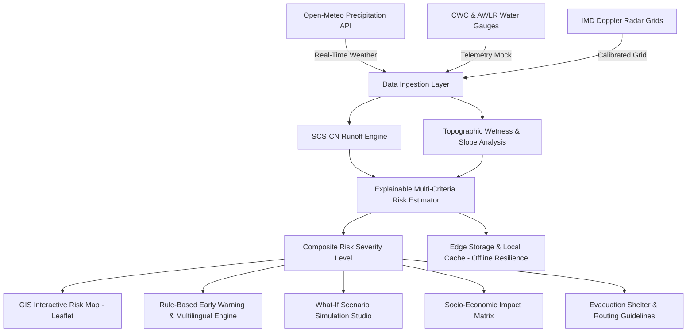

# FLOODX — AI-Powered Flood Intelligence for a Safer Tomorrow

**Smart India Hackathon 2026 • Presidency University, Bengaluru**  
*Mission: Predict. Understand. Simulate. Act.*

---

## 1. Executive Summary & Product Vision

**FLOODX** is a unified, presentation-ready flood disaster intelligence platform engineered for:
- **Disaster Management Authorities**: National Disaster Management Authority (NDMA), State Disaster Management Authorities (SDMAs), and District Disaster Management Authorities (DDMAs).
- **Urban Local Bodies (ULBs)**: Bruhat Bengaluru Mahanagara Palike (BBMP), Greater Chennai Corporation, Municipal Corporation of Greater Mumbai (MCGM), etc.
- **Emergency First Responders**: National Disaster Response Force (NDRF), State Disaster Response Forces (SDRF), Fire and Emergency Services.
- **Vulnerable Communities & Citizens**: Automated early warnings, safe evacuation shelter discovery, and localized waterlogging risks.

FLOODX transitions disaster response from reactive damage mitigation to proactive edge intelligence, enabling decision-makers to predict flood exposure, understand hydrological attribution, simulate extreme cloudburst and dam release scenarios, and execute life-safety evacuation actions.

---

## 2. Core Architecture & Tech Stack



### Technology Highlights
- **Frontend / Full-Stack**: Next.js 14 (App Router), React 18, TypeScript.
- **Styling & Operational Theme**: Tailwind CSS with custom glassmorphic dark operational palette (`#070b16` deep navy, `#06b6d4` oceanic cyan, risk tier indicators).
- **Geospatial GIS Visualization**: Leaflet with OpenStreetMap, Esri Satellite World Imagery, and OpenTopoMap basemaps. Custom interactive layers for inundation hazard polygons, rajakaluves (stormwater canals), critical lifelines, and AWLR telemetry stations.
- **Scientific Hydrological Engine**:
  - USDA/NRCS **SCS-CN (Soil Conservation Service Curve Number)** method for direct surface runoff yield.
  - **IMD Standard Rainfall Classification** (Light, Moderate, Heavy, Very Heavy, Extremely Heavy).
  - Topographic slope attenuation and valley bowl stagnation calculations.
  - Transparent **Explainable AI (XAI)** factor attribution with exact mathematical formulas and data quality audits.
- **What-If Scenario Simulation Studio**: Live parameter sliders for precipitation rate (up to 180 mm/h cloudbursts), duration, soil saturation, drainage channel choking, and upstream reservoir discharge.
- **Resilience**: Complete client-side caching (LocalStorage/IndexedDB) and manual **Offline Mode** simulation toggle.
- **Multilingual Emergency Alerts**: In-app rule engine generating instant broadcasts in **English**, **Kannada (ಕನ್ನಡ)**, **Hindi (हिन्दी)**, and **Tamil (தமிழ்)**.

---

## 3. Implemented Features vs. Planned Roadmap

| Module | Feature | Implementation Status | Notes |
|---|---|---|---|
| **Landing Page** | Executive disaster intelligence portal | ✅ Implemented | SIH 2026 & Presidency University branding, quick CTAs |
| **Operational Dashboard** | Real-time weather, risk meter, trends, alerts | ✅ Implemented | Live SVG radial gauge, 24h precipitation/runoff bar chart |
| **Location Selector** | Multi-basin picker & custom coordinate analyzer | ✅ Implemented | Bengaluru, Chennai, Mumbai, Guwahati, Patna, Wayanad + Custom Lat/Lng |
| **GIS Hazard Map** | Multi-layer interactive Leaflet GIS | ✅ Implemented | Satellite/Dark/Topo basemaps, hazard zones, infrastructure pins |
| **Risk XAI Engine** | Transparent weighted factor breakdown | ✅ Implemented | SCS-CN calculations ($S, I_a, Q$), data quality audit |
| **Simulation Studio** | What-if scenario stress-testing | ✅ Implemented | Live sliders, side-by-side delta cards, flood depth projection |
| **Impact Assessment** | Demographic & road network exposure | ✅ Implemented | Census overlay, impassable road stretches, JSON brief exporter |
| **Early Warning** | Rule-based engine & multilingual broadcasts | ✅ Implemented | English, Kannada, Hindi, Tamil broadcast templates |
| **Evacuation Support** | Safe haven shelter locator & routing guidelines | ✅ Implemented | High-elevation relief centers, "Turn Around Don't Drown" warnings |
| **Data Adapters** | Open-Meteo Live API + Calibrated Mocks | ✅ Implemented | Zero paid API dependencies |
| **Edge Resilience** | Offline caching & simulated offline mode | ✅ Implemented | Operates with degraded connectivity or offline |
| **Backend REST APIs** | Modular Next.js API Routes | ✅ Implemented | `/api/locations`, `/api/weather`, `/api/risk-assessment`, etc. |
| **2D Hydrodynamics** | Full HEC-RAS / TUFLOW numerical solver | 📋 Planned Phase 2 | Requires HPC cluster infrastructure and high-res LiDAR DEMs |
| **SMS Gateway** | Direct cell-broadcast telecom integration | 📋 Planned Phase 2 | Requires DoT / NDMA CAP-CP authorization |

---

## 4. How to Run Locally & Demonstrate Without Paid APIs

FLOODX is configured to work **100% out of the box** without any paid API keys or external subscription dependencies:
- Real-time weather observations are fetched directly from **Open-Meteo's** free open meteorological API.
- River telemetry, radar reflectivity, and geospatial assets use calibrated benchmark profiles for Indian river basins.

### Quick Start
```bash
# 1. Clone repository & navigate to project directory
cd "FLOOD X"

# 2. Install dependencies (if not already installed)
npm install

# 3. Run algorithmic unit test suite
npm test

# 4. Start local development server
npm run dev
```

Open [http://localhost:3000](http://localhost:3005) in your browser.

---

## 5. Walkthrough Demo Guide for Hackathon Judges

1. **Executive Landing Page**:
   - Note the clear mission philosophy: *Predict. Understand. Simulate. Act.*
   - Click **"Open Flood Dashboard"**.
2. **Operational Command Dashboard**:
   - Select **Bengaluru (Bellandur & Varthur Catchment)** from the top navigation.
   - Inspect the **Composite Flood Risk Meter (0-100)** and live 24h precipitation rate.
   - Hover over the **24-Hour Observed Rainfall & Runoff Profile** chart to see the correlation between hourly precipitation and surface runoff yield.
3. **Interactive GIS Flood Map**:
   - Click the **"GIS Flood Map"** tab.
   - Switch between **Dark Matter**, **Esri Satellite**, and **Topography** basemaps.
   - Toggle layers: Inundation Hazard Zones, River & Trunk Drains, Critical Facilities (Hospitals, Substations), and Telemetry Gauges.
   - Click anywhere on the map to query latitude, longitude, and approximate topographic elevation.
4. **Explainable AI (XAI) Risk Decomposition**:
   - Click the **"Risk XAI Engine"** tab.
   - Review the transparent factor breakdown (weights summing exactly to 100%).
   - Examine the SCS-CN formula card displaying Potential Retention ($S$), Initial Abstraction ($I_a$), and Runoff Coefficient.
   - Review actionable directives separated by stakeholder (Citizens, BBMP/ULBs, NDRF/SDRF).
5. **What-If Scenario Simulation Studio**:
   - Click the **"What-If Simulation"** tab.
   - Click the preset **"⚡ Cloudburst (110 mm/h)"**.
   - Watch the real-time recalculation: baseline vs simulated score, delta points, estimated inundation depth (~cm), and impassable road mileage.
6. **Early Warning Center & Multilingual Broadcasts**:
   - Click the **"Early Warnings"** tab.
   - Switch between **English**, **ಕನ್ನಡ (Kannada)**, **हिन्दी (Hindi)**, and **தமிழ் (Tamil)** to demonstrate public broadcast dissemination.
   - Click **"Simulate Demo Alert"** to trigger a test warning and demonstrate acknowledgment.
7. **Offline-First Resilience**:
   - Click the **"Live Feeds / Offline Mode"** toggle in the top-right navbar.
   - Notice the amber persistent banner: the application switches to cached edge mode with zero latency or network errors.

---

## 6. Assumptions and Scientific Disclosures

1. **Hydrological Heuristics vs 2D Hydrodynamics**:
   FLOODX uses an empirical multi-criteria index (SCS Curve Number, slope decay, IMD intensity brackets) to provide instant edge situational awareness. This does not replace complex 2D hydrodynamic numerical solvers (HEC-RAS, MIKE 21, TUFLOW) which model momentum and Navier-Stokes equations across fine-resolution digital elevation models.
2. **Demographic & Infrastructure Data**:
   Population figures are heuristic estimates combining catchment boundary envelopes with national census density rasters. Road inundation viability uses topographic depression profiles and historical flashpoint records.
3. **Statutory Warnings**:
   Demonstration alerts in FLOODX are for simulation, preparedness, and training drills. Real-world emergency evacuations must follow formal statutory orders from NDMA, SDMA, and local district authorities.

---

## 7. Real Datasets & Credentials for Production Deployment

For full nationwide government deployment, the following data feeds can be configured:
- **India Meteorological Department (IMD)**: Direct Doppler Weather Radar (DWR) NetCDF reflectivity grids and Automatic Weather Station (AWS) API keys.
- **ISRO / NRSC Bhuvan**: Authenticated WMS/WFS endpoints for Sentinel-1/RISAT SAR flood inundation products and 0.5m Cartosat Digital Elevation Models (DEM).
- **Central Water Commission (CWC)**: Automated Water Level Recorder (AWLR) real-time stage telemetry API credentials.
- **Common Alerting Protocol (CAP-CP)**: National Disaster Management Authority (NDMA) cell-broadcast gateway credentials for localized emergency SMS and siren alerts.

---

*Designed and Developed by Presidency University Bengaluru for Smart India Hackathon 2026.*
